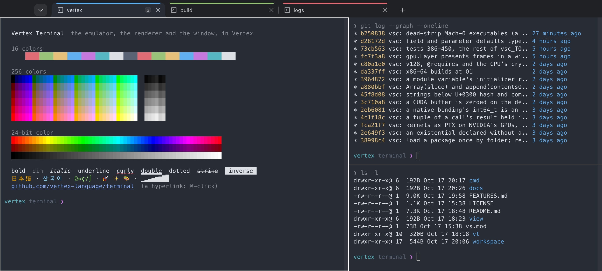
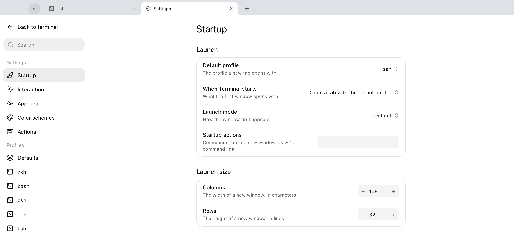

<h1 align="center">Vertex Terminal</h1>

<p align="center">
  <b>A modern terminal: tabs, panes, every color, and a settings page.</b><br>
  Written in Vertex, from the pseudo-terminal to the pixels.
</p>

<p align="center">
  <a href="#get-started">Get started</a> ·
  <a href="#features">Features</a> ·
  <a href="#keyboard">Keyboard</a> ·
  <a href="#settings">Settings</a> ·
  <a href="#how-its-built">How it's built</a>
</p>

<p align="center">
  
</p>

## Features

- **Every color, every style.** 16, 256 and 24-bit color; bold, italic, dim,
  strike and inverse; curly, double, dotted and dashed underlines in colors of
  their own; clickable OSC 8 hyperlinks; sixel images; CJK and emoji at double
  width; all of Windows Terminal's color schemes, light and dark.
- **Tabs and panes.** Chrome-style tabs in the title bar -- drag one to
  reorder it, give it a color, rename it -- each split into panes in any
  direction, to resize, zoom, swap, or type into all at once.
- **Settings two ways.** Press ⌘, for a Settings tab, or edit `settings.json`
  in Windows Terminal's own format: profiles, color schemes, actions and keys,
  applied the moment they're saved.
- **Everything at a keystroke.** ⌘⇧P lists every action with its keys. Find
  with ⌘F, jump between prompts with ⌘↑ ⌘↓, select with the mouse, the
  keyboard (mark mode) or by block.
- **Your session, kept.** Tabs, panes and their directories come back the
  next time it opens, if you want them to.
- **Small and native.** One executable of under 5 MB, drawn by its own
  renderer: no Electron, no system web view.

[FEATURES.md](FEATURES.md) goes through Windows Terminal's features one by
one, and says which are here.

## Get started

Vertex Terminal builds with [`vsc`](https://github.com/vertex-language/vsc),
the Vertex compiler. It is tested on macOS today; Linux and Windows are next
(see the [roadmap](#roadmap)).

```bash
git clone https://github.com/vertex-language/terminal
cd terminal
vsc run terminal
```

It opens your `$SHELL` as a login shell. It also takes Windows Terminal's
`wt` command line, to open a layout:

```bash
vsc run terminal -- new-tab -p bash -d ~/src \; split-pane -V   # bash in ~/src, split
vsc run terminal -- --light                                     # or --dark
```

`TERM` is `xterm-256color`, with `COLORTERM=truecolor` and
`TERM_PROGRAM=vertex-terminal`.

## Keyboard

The keys as macOS has them; settings.json binds any of them anew.

| Keys | Do |
| :--- | :--- |
| ⌘⇧P | the command palette: every action, with its keys |
| ⌘T, ⌘⇧1–⌘⇧9, ⌘⇧Space | new tab; with that profile; the profiles menu |
| ⌘W, ⌘⇧W | close the pane (the tab with its last), close the window |
| ⌘⇧T, ⌘⇧O | reopen the last closed tab, duplicate the tab |
| ⌘1–⌘8, ⌘9, ⌘⇧[ ⌘⇧], ⌃Tab | that tab, the last tab, previous/next (⌃Tab: the switcher) |
| ⌘D, ⌘⇧D, ⌥⇧+, ⌥⇧- | split right, down; duplicate right, down |
| ⌘⌥arrows, ⌘[ ⌘], ⌘⌃arrows, ⌘⇧↩ | focus a pane, the previous/next, resize, zoom |
| ⌘F, ⌘G ⌘⇧G | find, next/previous match |
| ⌘C ⌘V ⌘A, ⌘⇧M | copy, paste (with warnings), select all; mark mode |
| ⌘↑ ⌘↓, ⌘⇧← ⌘⇧→ | previous/next prompt (shell integration); select command/output |
| ⇧PageUp ⇧PageDown, ⌘Home ⌘End | scroll |
| ⌘K, ⌘S | clear the buffer, export it to ~/Downloads |
| ⌘+ ⌘- ⌘0, ⌘ wheel, ⌘⇧ wheel | font size; opacity |
| ⌃⌘F | fullscreen |
| ⌘,  ⌘⇧, | the Settings tab; settings.json |
| drag, double-, triple-click, ⇧-click, ⌥-drag | select characters, a word, a line, extend, a block |
| ⌘-click | open a hyperlink or URL |
| right-click | the menu: copy, paste, split, find, read-only, export… |

On macOS, Option composes characters as everywhere else;
`TERMINAL_OPTION_AS_META=1` makes it Meta instead, for a shell's Alt bindings.

## Settings

<p align="center">
  
</p>

The Settings tab (⌘,) has startup, interaction and appearance, the color
schemes, every action and its keys, the defaults every profile starts from,
and each profile. A change is written to `settings.json` at once.

`settings.json` lives in your configuration folder, under `vertex-terminal/`
(on macOS, `~/Library/Application Support/vertex-terminal/`), or wherever
`$VERTEX_TERMINAL_SETTINGS` says, in [Windows Terminal's
format](https://learn.microsoft.com/windows/terminal/customize-settings/) with
`cmd` for ⌘. It's written the first time with a profile for each shell in
`/etc/shells`.

```jsonc
{
    "defaultProfile": "zsh",
    "copyOnSelect": true,
    "firstWindowPreference": "persistedWindowLayout",
    "profiles": {
        "defaults": { "colorScheme": "One Half Dark", "font": { "face": "SF Mono", "size": 13 }, "cursorShape": "bar" },
        "list": [ { "name": "Logs", "commandline": "tail -f /var/log/system.log", "tabColor": "#C50E1F" } ]
    },
    "keybindings": [ { "keys": "cmd+shift+e", "id": "Terminal.ToggleBroadcastInput" } ]
}
```

## How it's built

About 11,600 lines of Vertex, in three packages:

| Package | What it is |
| :--- | :--- |
| [`vt`](vt) | The emulator: bytes in, a screen of cells out. A DEC/xterm parser (UTF-8, CSI, OSC, DCS), the main and alternate screens, scrollback with reflow, scrolling regions and margins, SGR colors and underline styles, grapheme clusters, double-width and double-height lines, hyperlinks, shell-integration marks, sixel images, the kitty keyboard protocol, and the reports programs ask for. No I/O, no drawing. |
| [`view`](view) | The renderer: a screen into pixels, in a monospaced font and a color scheme, with the cursor shapes, selections, search matches, images and the scrollbar. Box drawing is drawn as shapes so lines meet; only the rows that changed are drawn again. |
| [`workspace`](workspace) | The window, in `.vsx` and `.vss`: the tab bar, panes, the command palette, find, menus and dialogs, the Settings tab, keys and actions, the pointer and the clipboard, each pane's shell under `os/pty`, and `settings.json`. |

```
cmd/terminal   app.Run { <workspace.TerminalWindow /> }
      │
workspace      tabs, panes, palette, settings (.vsx/.vss) · Controller · Shell ──► os/pty
      │                                   │
      ├──── view (pixels) ◄──── vt (screen, scrollback, modes) ◄── the shell's bytes
      │
ui/viewport ── ui/app ── web (page, events) ── ui/window
```

The window's chrome is a `.vsx` page laid out and painted by the
[`web`](https://github.com/vertex-language/web) engine, also written in
Vertex; each pane's text is drawn straight into a `ui/viewport` beside it.
A shell's output arrives in a task on the main actor: its bytes go to
`vt.Feed`, the replies the screen owes (cursor reports, device attributes)
go back, and the next frame draws the rows that changed -- 200,000 lines of
`seq` reach the screen in about a quarter of a second.

## Development

```bash
vsc run check                         # the emulator's checks, offline
vsc run check-ui                      # the window, headless, with real shells
vsc run render-snapshot -- out.png    # what view draws, as a PNG
```

The app takes a few flags for tests and pictures: `--snapshot out.png
--snapshot-after 2` draws the window two seconds in and quits, `--action <id>`
runs an action at startup (`--action Terminal.ToggleCommandPalette`), and
`--quit-after 3` quits as ⌘Q does. The screenshots above are
[`docs/showcase.sh`](docs/showcase.sh); its header has the command.

```
terminal/
  vt/          the emulator
  view/        the renderer
  workspace/   the window, its Settings tab and settings.json
  cmd/
    terminal/         the app
    check/            vt's checks
    check-ui/         the window mounted headless, typed into, with real shells
    render-snapshot/  a sample screen drawn to a PNG
  docs/        the screenshots, and the script that makes them
  FEATURES.md  Windows Terminal's features, and which are here
```

## Roadmap

[FEATURES.md](FEATURES.md) has the full list. The larger pieces still to come
are:

- **Linux and Windows.** Vertex builds for both; the terminal needs their
  window and title-bar integration, and on Windows a ConPTY behind `os/pty`.
- Several windows, and quake mode.
- Background images and acrylic.
- Ligatures, regex search, and copying as HTML.

## License

[MIT](LICENSE)
